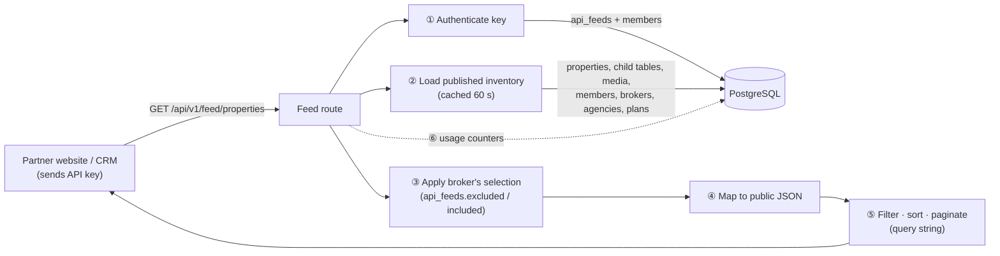
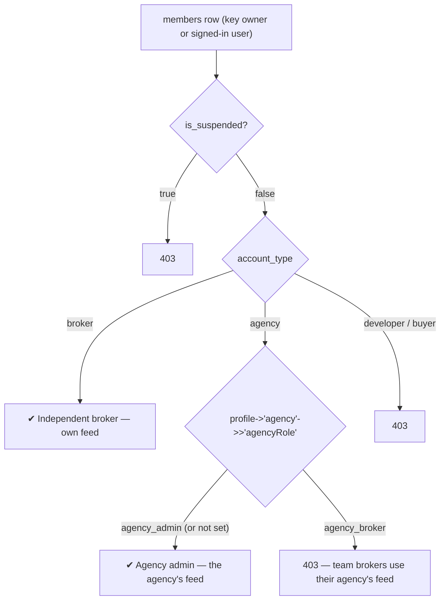
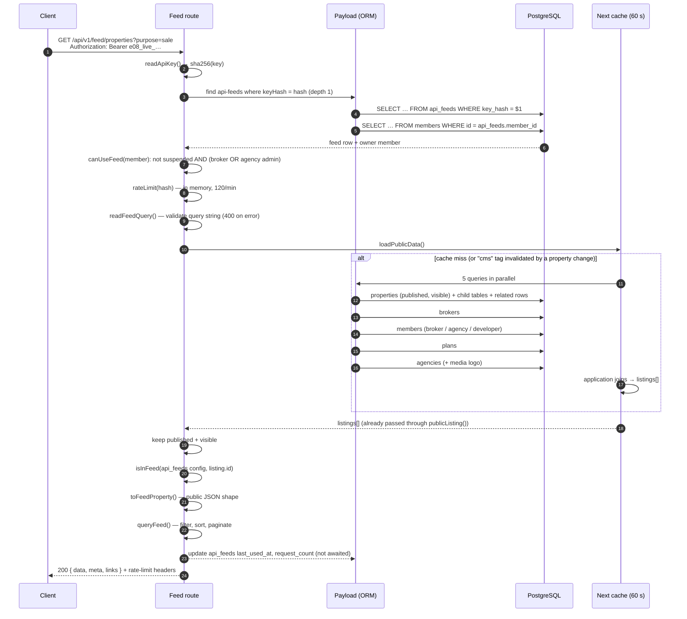
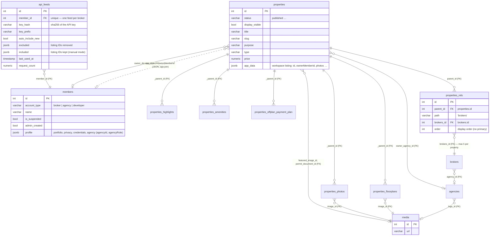
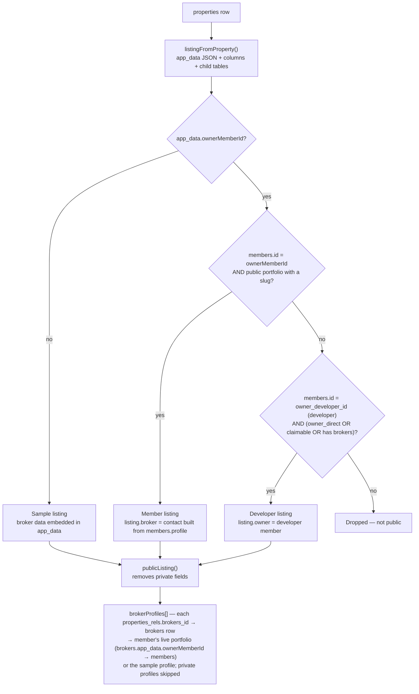
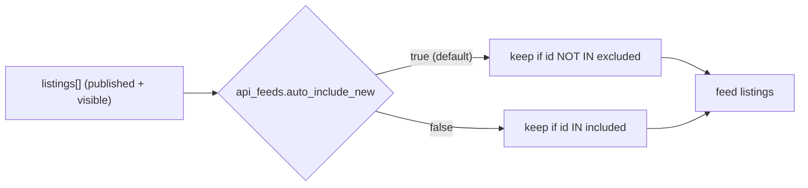
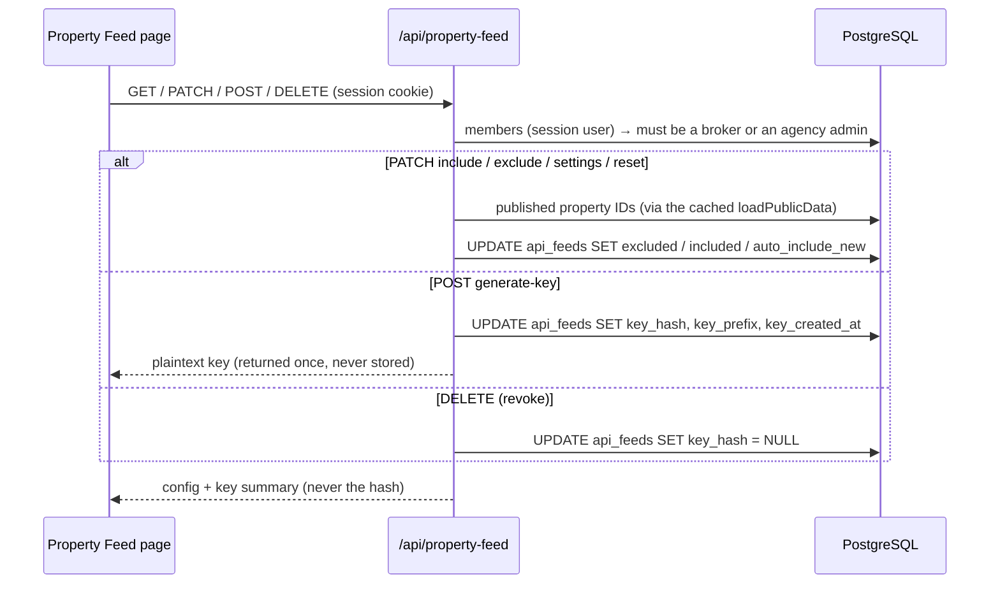
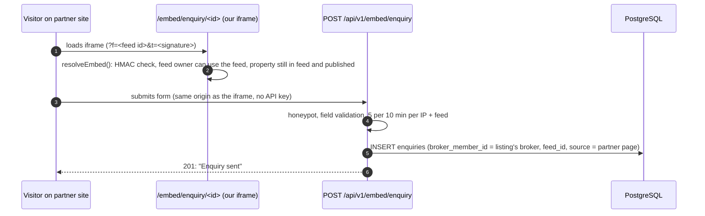

# Property Feed API — how a request is served

How `GET /api/v1/feed/properties` turns an API key into a list of properties: which tables are read, how they are joined, and where each response field comes from.

The feed is available to **independent brokers** and **agency admins**. Both work the same way; section 1a shows the differences.

**Code:** [route.ts](src/app/api/v1/feed/properties/route.ts) · [server/propertyFeed.ts](src/lib/server/propertyFeed.ts) · [propertyFeed.ts](src/lib/propertyFeed.ts) · [publicData.ts](src/lib/server/publicData.ts) · [member-properties.ts](src/lib/server/member-properties.ts) · [publicListing.js](src/lib/publicListing.js)

---

## 1. The big picture



There are two kinds of "join" in this request:

| Kind | Where | Example |
|---|---|---|
| **Database join** (foreign key column) | Payload loads related rows with `depth: 1` | `api_feeds.member_id → members.id`, `properties.featured_image_id → media.id` |
| **Application join** (in TypeScript, through a value inside JSON) | `loadPublicData()` builds maps and matches by ID | `properties.app_data->>'ownerMemberId' → members.id` |

Member listings are matched to their owner by an **application join**: the owner's ID lives inside the `app_data` JSON column, not in a foreign key.

---

## 1a. Who can use the feed: brokers and agencies



The rule lives in one function, `canUseFeedAccount()` in [propertyFeed.ts](src/lib/propertyFeed.ts). It's used by the API, the workspace endpoint and the sidebar.

| | Independent broker | Agency admin |
|---|---|---|
| `members.account_type` | `broker` | `agency` |
| `members.profile->'agency'->>'agencyRole'` | not set | `agency_admin` |
| `api_feeds` row | one, linked by `member_id` | one, linked to the admin's `member_id` |
| Properties in the feed | every published property (minus removals) | the same — every published property (minus removals) |
| "My listings" filter on the page | `app_data->>'ownerMemberId' = members.id` | the same, **or** `properties.owner_agency_id = profile->'agency'->>'agencyId'`, which also covers the team brokers' listings |
| Where the page is | Sidebar → Network → Property Feed API | Sidebar → Property Feed API |

The feed is stored **per member**, not per agency. If an agency has more than one admin account, each admin has their own key and selection.

---

## 2. Request sequence



---

## 3. Tables and how they connect



**Brokers per property:** a property has **0 to 5 brokers** and none of them is "primary". Payload stores this many-to-many link in `properties_rels` (one row per broker, `path = 'brokers'`). The old `primary_broker_id` and `broker_id` columns were removed by migration `20261126_000001_property_brokers`, which moved each property's broker into this table.

| Owner | Who can be one of its brokers |
|---|---|
| Independent broker | Only themselves (set automatically on save) |
| Agency | Up to 5 brokers on the agency's own team |
| Developer | Up to 5 registered brokers, picked in the editor or added by approving claims. Claims stay open until there are 5 |

Payload stores each **list field** of `properties` (highlights, amenities, photos, floor plans, the off-plan payment plan) in its own child table, linked back by `_parent_id` and ordered by `_order`. Payload creates and fills these tables itself.

---

## 4. Step by step, with the SQL behind it

Payload writes the SQL itself. The statements below show the equivalent queries, for reading and debugging.

### ① Authenticate the key: `api_feeds` ⋈ `members`

```sql
-- 1a. find the feed by the hash of the key that was sent
SELECT * FROM api_feeds WHERE key_hash = encode(sha256('e08_live_…'::bytea), 'hex') LIMIT 1;

-- 1b. depth: 1 loads the owner (database join on the foreign key)
SELECT id, account_type, is_suspended, profile->'agency'->>'agencyRole' AS agency_role
FROM members WHERE id = :member_id;
```

| Result | Response |
|---|---|
| No row | `401` invalid or revoked key |
| Suspended, or not an independent broker or agency admin (see 1a) | `403` |
| More than 120 calls in a minute | `429` |

### ② Load the published inventory: `loadPublicData()` (5 queries in parallel, cached)

```sql
-- 2a. published, visible properties (limit 500) …
SELECT * FROM properties
WHERE status = 'published' AND display_visible IS DISTINCT FROM false
LIMIT 500;

-- … and, because depth = 1, their child rows and related records
SELECT * FROM properties_highlights           WHERE _parent_id = ANY(:property_ids) ORDER BY _order;
SELECT * FROM properties_amenities            WHERE _parent_id = ANY(:property_ids) ORDER BY _order;
SELECT * FROM properties_photos               WHERE _parent_id = ANY(:property_ids) ORDER BY _order;
SELECT * FROM properties_floorplans           WHERE _parent_id = ANY(:property_ids) ORDER BY _order;
SELECT * FROM properties_offplan_payment_plan WHERE _parent_id = ANY(:property_ids) ORDER BY _order;
SELECT * FROM media    WHERE id = ANY(:featured_image_ids, :photo_image_ids, :permit_document_ids);
SELECT * FROM properties_rels WHERE parent_id = ANY(:property_ids) AND path = 'brokers' ORDER BY "order";
SELECT * FROM brokers  WHERE id = ANY(:brokers_ids_from_properties_rels);
SELECT * FROM agencies WHERE id = ANY(:owner_agency_ids);
SELECT * FROM members  WHERE id = ANY(:owner_developer_ids);

-- 2b. sample (seeded) broker profiles
SELECT * FROM brokers LIMIT 500;

-- 2c. professional members (used as listing owners / contacts)
SELECT * FROM members
WHERE account_type IN ('broker', 'agency', 'developer') AND admin_created IS DISTINCT FROM true
LIMIT 500;

-- 2d / 2e. plans, and agencies with their logo (loaded for the public site; not used in the feed output)
SELECT * FROM plans ORDER BY sort_order;
SELECT * FROM agencies LIMIT 500;  -- + media for logo_id
```

**The cache:** this whole block is wrapped in `unstable_cache` (60 s, tag `cms`). Saving a property clears the `cms` tag, so a change shows up on the next request. Most feed calls never reach the database for this step.

### ③ The application joins inside `loadPublicData()`



Equivalent SQL for a property's brokers:

```sql
SELECT r."order", b.id AS broker_row, m.id AS member_id, m.profile->'portfolio'->>'displayName' AS name
FROM properties_rels r
JOIN brokers b      ON b.id = r.brokers_id
LEFT JOIN members m ON m.id = (b.app_data->>'ownerMemberId')::int   -- application join (JSON)
WHERE r.parent_id = :property_id AND r.path = 'brokers'
ORDER BY r."order";
```

Equivalent SQL for the member-listing join:

```sql
SELECT p.*, m.account_type, m.profile
FROM properties p
JOIN members m ON m.id = (p.app_data->>'ownerMemberId')::int
WHERE p.status = 'published'
  AND p.display_visible IS DISTINCT FROM false
  AND COALESCE((m.profile->'portfolio'->>'isPublic')::bool, true)
  AND COALESCE((m.profile->'portfolio'->>'searchable')::bool, true)
  AND m.profile->'portfolio'->>'slug' IS NOT NULL;
```

A published listing whose owner has a **private or non-searchable portfolio** is left out of the public site, so it is left out of the feed as well.

`publicListing()` removes `ownerMemberId`, editor answers, unit and broker references, price history and the quality score, and hides exact location or floor when the broker chose that.

### ④ Apply the broker's selection: `api_feeds`



```sql
-- equivalent, with auto_include_new = true
SELECT * FROM published_listings l
WHERE NOT (f.excluded ? l.id);   -- f = this key's api_feeds row
```

### ⑤ Map, filter, sort, paginate (in memory)

`toFeedProperty()` builds the documented JSON. Then `queryFeed()` applies `purpose`, `type`, `category`, `completion`, `emirate`, `area`, `q`, `minPrice`/`maxPrice`, `minBeds`/`maxBeds`, `updatedSince` and `ids`, sorts, and cuts out the requested page. No further database access happens here.

### ⑥ Usage counters

```sql
UPDATE api_feeds SET last_used_at = now(), request_count = request_count + 1 WHERE id = :feed_id;
```

This update isn't awaited, so a failure is logged and never fails the API call.

---

## 5. Where each response field comes from

| Response field | Table / column |
|---|---|
| `id` | `properties.app_data->>'id'` (falls back to `properties.id`) |
| `reference`, `slug`, `title`, `purpose`, `category`, `type`, `completion` | `properties.ref`, `slug`, `title`, `purpose`, `category`, `type`, `completion` |
| `price.amount`, `price.onRequest` | `properties.price`, `price_on_request` |
| `price.frequency` | `properties.rent_frequency` (rent only) |
| `price.previousAmount` | `properties.app_data->>'previousPrice'` |
| `bedrooms`, `bathrooms`, `parking`, `floor`, `size.value` | `properties.beds`, `baths`, `parking`, `floor`, `size` |
| `location.*` | `properties.emirate`, `area`, `community`, `address`, `coordinates_lat`, `coordinates_lng` |
| `description` | `properties.description` |
| `highlights` | `properties_highlights.highlight` |
| `amenities` | `properties_amenities.amenity` |
| `featuredImage`, `images[]` | Member listings: `properties.app_data` → `featured`, `photos[]`. Other listings: `media.url` through `featured_image_id` and `properties_photos.image_id` |
| `permit` | `properties.permit_number`, `permit_expiry` |
| `offplan` | `properties.offplan_developer`, `offplan_handover`, `properties_offplan_payment_plan` |
| `contact.kind`, `contact.agency` | Listing owner in `members`: `broker` (independent), `agency` (agency's own listing, `agency` = its name), `broker` for a team broker (`agencyRole = agency_broker`, `agency` = `profile->'agency'->>'name'`), or `developer` |
| `brokers[]` (0–5; `name`, `agency`, `brn`, `photo`, `profileUrl`) | `properties_rels` (`path = 'brokers'`) → `brokers` → `members.profile->'portfolio'` for member brokers, or `brokers.app_data` for sample brokers. Independent brokers' older listings fall back to the owner |
| `contact.name`, `photo`, `profileUrl` | `members.profile->'portfolio'` (`displayName`, `photo`, `slug`), filtered by `members.profile->'privacy'` |
| `enquiry.embedUrl`, `enquiry.embedHtml` | Calculated: `/embed/enquiry/<id>?f=<api_feeds.id>&t=<signature>` and a ready-to-paste `<iframe>` (see section 8) |
| `contact.brn` | `members.profile->'credentials'->>'brn'` |
| `createdAt`, `updatedAt` | `properties.created_at`, `updated_at` |
| `url`, `price.currency`, `size.unit`, `meta`, `links` | Calculated, not stored |

---

## 6. The workspace endpoint (`/api/property-feed`)

The broker's **Property Feed API** page uses a separate, session-authenticated endpoint to manage the same `api_feeds` row.



---

## 7. Limits worth knowing

- **Inventory cap:** `loadPublicData()` reads at most 500 published properties, so the feed can't return more than that.
- **Freshness:** removing a property from the feed takes effect on the next call, because `api_feeds` is read on every request. A newly published property appears after the `cms` cache tag is cleared, which normally happens at once and at most 60 s later.
- **Rate limit:** counted in memory per server instance (120 per minute per key).
- **Not a SQL join for owners:** because `ownerMemberId` is inside JSON, the database can't index or enforce that link. If the feed grows large, add a real `owner_member_id` column to `properties` with a foreign key.

---

## 8. Enquiries from partner websites (embedded form)

Leads from partner websites must come to Emirate08. That's why the feed carries **no broker phone, WhatsApp or email** (`contact` and `brokers[]` have name, agency, BRN, photo and profile link only). Instead, each property has `enquiry.embedHtml`: an iframe with our enquiry form, which the partner pastes on the property's page.



- **Signature:** `t` is an HMAC-SHA256 (key `PAYLOAD_SECRET`) of the feed ID and property ID, so a partner can't credit enquiries to another feed or open a form for a property outside its feed. It doesn't expire; the form stops working when the property leaves the feed, is unpublished, or the feed owner is suspended.
- **Who receives the enquiry:** the property's broker, exactly as on the property page (`listing.brokerId`: the owner for member listings, the first broker for developer listings). The enquiry records `enquiries.feed_id` → `api_feeds`, so admins can see which partner sent it.
- **Partner page:** taken from the iframe's `document.referrer` and stored in `enquiries.source`. Browsers often send only the origin.
- **Framing:** `next.config.mjs` sends `Content-Security-Policy: frame-ancestors *` and `X-Robots-Tag: noindex` for `/embed/*` only.
- **Auto height:** the iframe posts `{ type: 'emirate08:enquiry-height', propertyId, height }` to the parent page. The default `height` in `embedHtml` is 620 px.

```html
<script>
  window.addEventListener('message', function (e) {
    if (!e.data || e.data.type !== 'emirate08:enquiry-height') return;
    document.querySelectorAll('iframe[src*="/embed/enquiry/' + e.data.propertyId + '?"]').forEach(function (f) {
      f.style.height = e.data.height + 'px';
    });
  });
</script>
```

The API can't stop a partner from leaving out the iframe. Make embedding it a condition of the API terms, and compare each feed's requests with its enquiries (`enquiries.feed_id`).
